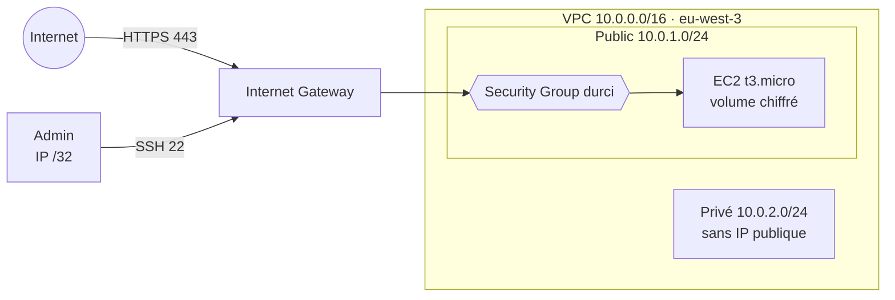

# AWS Security Baseline : déploiement durci et audit automatisé


> « Security is not a product, but a process. » Bruce Schneier

| | |
| --- | --- |
| **Type** | Projet personnel, compte AWS réel (offre gratuite) |
| **Contact** | [LinkedIn](https://www.linkedin.com/in/wilfrid-nguimdo-780283336) |

---

## Synthèse

Une grande partie des incidents cloud vient d'erreurs de configuration : un bucket S3 public, un utilisateur sans MFA, un port d'administration ouvert à tout Internet.

Ce projet répond à une question simple : **à quoi ressemble une infrastructure AWS sécurisée dès le premier jour, et comment le vérifier automatiquement ?** Il combine deux briques :

1. **Déployer** un environnement durci en Infrastructure as Code avec **Terraform** ;
2. **Auditer** ensuite tout le compte AWS avec un **scanner Python (boto3)** qui interroge les API réelles et produit un rapport de sécurité horodaté.

## Résultats clés

| Indicateur | Résultat |
| --- | --- |
| Ressources déployées par Terraform | **8** (VPC, 2 sous-réseaux, passerelle, routage, Security Group, EC2) |
| Contrôles de sécurité automatisés | **5** (S3, IAM, EC2) |
| Constats CRITICAL sur l'infrastructure déployée | **0** |
| Constat remonté par l'audit | **1 HIGH** : utilisateur IAM `user_test` sans MFA, créé hors du projet |
| Ports d'administration ouverts à Internet | **0** (SSH limité à une IP `/32`) |
| Données au repos | Volume EC2 **chiffré** |
| Ressources orphelines après la session | **0** (`terraform destroy`) |

## Architecture



Détail des ressources et des choix : [docs/architecture.md](docs/architecture.md)

## Principes de sécurité appliqués

| Principe | Mise en œuvre |
| --- | --- |
| **Défense en profondeur** | VPC isolé, Security Group filtrant, volume chiffré : une couche qui tombe n'expose pas les autres |
| **Moindre exposition** | SSH limité à une seule IP, HTTPS seul ouvert, HTTP fermé, sous-réseau privé sans IP publique |
| **Aucun secret dans le code** | IP d'administration en variable validée (`/32` obligatoire), état Terraform et `tfvars` exclus du dépôt |
| **Auditabilité** | Chaque constat est daté, classé par gravité et enregistré dans un rapport JSON |
| **Maîtrise des coûts** | Instance éligible à l'offre gratuite, destruction complète en fin de session |

## Les 5 contrôles de l'audit

| Contrôle | Service | Gravité |
| --- | --- | --- |
| Bucket rendu public par sa politique | S3 | CRITICAL |
| Chiffrement du bucket absent | S3 | HIGH |
| Utilisateur sans MFA | IAM | HIGH |
| Clé d'accès de plus de 90 jours | IAM | MEDIUM |
| Port sensible (SSH, RDP, MySQL, PostgreSQL, MongoDB, Redis) ouvert à `0.0.0.0/0` | EC2 | CRITICAL |

Appels API, format du rapport et analyse du résultat : [docs/controles-securite.md](docs/controles-securite.md)

## Mise en œuvre

**Prérequis** : Terraform ≥ 1.5, Python 3, un compte AWS avec des identifiants configurés (`aws configure`).

**1. Renseigner son adresse IP d'administration**

```bash
cd terraform
cp terraform.tfvars.example terraform.tfvars
# éditer terraform.tfvars : admin_ssh_cidr = "<votre IP publique>/32"
```

**2. Déployer l'infrastructure**

```bash
terraform init
terraform plan
terraform apply
```

**3. Lancer l'audit**

```bash
pip install -r requirements.txt
python scripts/audit.py
```

Sortie reconstituée à partir du rapport réel du 31 mars 2026 :

```
[*] Auditing IAM users...
[HIGH] IAM — user_test: MFA is not enabled — account vulnerable to brute force

[*] Auditing Security Groups...

==================================================
AUDIT COMPLETE
==================================================
Total findings : 1
Critical       : 0
High           : 1
Medium         : 0
Low            : 0
Report saved   : security_report_20260331_174314.json
==================================================
```

**4. Tout supprimer en fin de session**

```bash
terraform destroy
```

## Arborescence du dépôt

```
├── README.md
├── requirements.txt              # dépendance Python (boto3)
├── docs/
│   ├── architecture.md           # ressources, schéma, choix de sécurité
│   └── controles-securite.md     # contrôles de l'audit, rapport, résultats
├── scripts/
│   └── audit.py                  # scanner de sécurité (S3, IAM, EC2)
└── terraform/
    ├── main.tf                   # VPC, sous-réseaux, routage, Security Group, EC2
    ├── variables.tf              # région, nom, environnement, IP d'administration
    ├── outputs.tf                # identifiants et IP publique en sortie
    └── terraform.tfvars.example  # modèle de configuration (sans valeur réelle)
```

## Compétences mobilisées

**Cloud AWS** : VPC, sous-réseaux, Internet Gateway, tables de routage, Security Groups, EC2, EBS, IAM, S3.
**Infrastructure as Code** : Terraform (fournisseur AWS, variables validées, outputs, cycle `plan` / `apply` / `destroy`).
**Automatisation** : Python, SDK boto3, génération de rapports JSON.
**Sécurité** : durcissement réseau, chiffrement au repos, MFA, rotation des clés, exposition des ports, hygiène des secrets dans Git.
