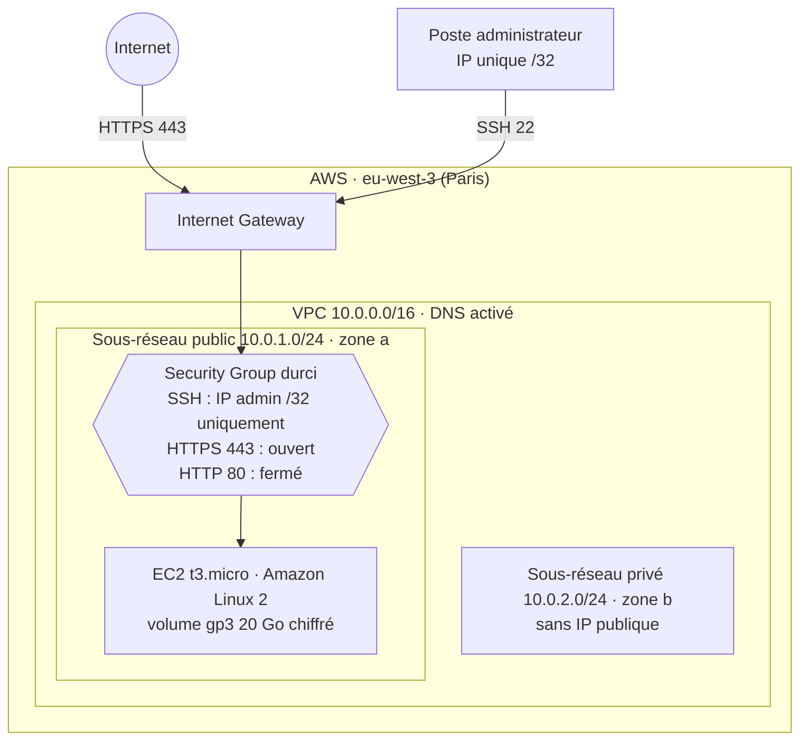

# Architecture et choix de sécurité

[← Retour au README](../README.md)

## Vue d'ensemble

## Ressources déployées

Le déploiement crée **8 ressources** (Terraform 1.10.5, fournisseur AWS `~> 5.0`).

| Ressource Terraform | Rôle | Paramètres de sécurité |
| --- | --- | --- |
| `aws_vpc.main` | Réseau isolé `10.0.0.0/16` | DNS interne activé, ressources étiquetées |
| `aws_subnet.public` | Sous-réseau `10.0.1.0/24`, zone `a` | Seul sous-réseau exposé |
| `aws_subnet.private` | Sous-réseau `10.0.2.0/24`, zone `b` | `map_public_ip_on_launch = false` : aucune IP publique |
| `aws_internet_gateway.main` | Accès Internet du VPC | Rattachée au seul sous-réseau public |
| `aws_route_table.public` | Route `0.0.0.0/0` → passerelle Internet | Associée au sous-réseau public uniquement |
| `aws_route_table_association.public` | Association route / sous-réseau | Le sous-réseau privé n'a pas de route vers Internet |
| `aws_security_group.main` | Pare-feu de l'instance | SSH limité à une IP `/32`, HTTPS seul ouvert, HTTP fermé |
| `aws_instance.main` | Serveur `t3.micro` (éligible à l'offre gratuite) | Volume racine `gp3` de 20 Go **chiffré**, supprimé avec l'instance |

## Choix de sécurité

### Défense en profondeur

Chaque couche protège indépendamment des autres :

1. **Réseau** : le VPC isole l'environnement ; le sous-réseau privé n'a ni IP publique ni route vers Internet.
2. **Filtrage** : le Security Group n'ouvre que le strict nécessaire (refus par défaut).
3. **Données** : le volume de l'instance est chiffré au repos.

### Moindre exposition

| Port | Source autorisée | Justification |
| --- | --- | --- |
| 22 (SSH) | Une seule IP, en `/32` | Administration. Jamais ouvert à `0.0.0.0/0`. |
| 443 (HTTPS) | `0.0.0.0/0` | Service web chiffré |
| 80 (HTTP) | — | Fermé volontairement : pas de trafic en clair |

L'adresse IP d'administration est une **variable** (`admin_ssh_cidr`) : elle n'est jamais écrite dans le code. Une règle de validation refuse toute valeur qui n'est pas une adresse unique en `/32`.

### Pas de secret dans le dépôt

- Les fichiers d'état Terraform (`terraform.tfstate`), qui contiennent les identifiants des ressources et du compte, sont exclus par le `.gitignore`.
- Les valeurs propres à chaque déploiement vont dans `terraform.tfvars`, également exclu ; seul le modèle `terraform.tfvars.example` est publié.
- Les rapports d'audit (`*.json`), qui listent les comptes et ressources du compte audité, ne sont pas publiés.

### Maîtrise des coûts

Instance `t3.micro` éligible à l'offre gratuite, et destruction complète de l'environnement en fin de session avec `terraform destroy`.
